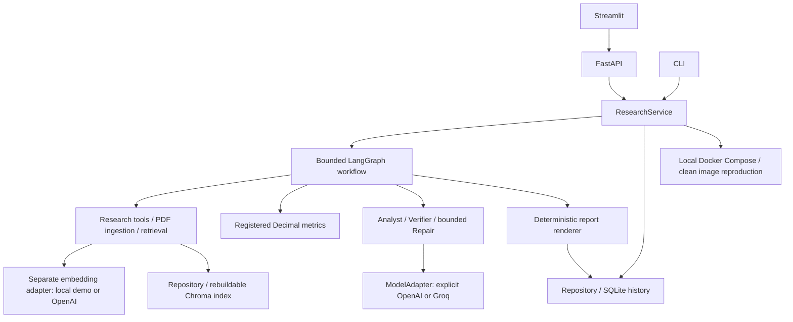

# RiskLens — Evidence-Aware Financial Risk Research Agent

**pre-v1 · 50-case P4 execution sealed · H4/H5 approved · quantified quality claims remain limited**

The publication snapshot includes the completed P4/P5 engineering scope and the owner's
H4/H5 approval. Private source files, reserve questions and raw audit logs remain local.

RiskLens explores a practical problem in financial research: an answer can sound convincing
while using the wrong period, miscalculating a ratio, or citing a passage that does not support
its conclusion. This Python prototype connects source evidence, deterministic calculations
and claim-level verification in an inspectable research workflow.

**This is a portfolio snapshot, not a validated financial decision system.** The keyless demo
uses simulated model decisions. No benchmark improvement or Verifier superiority is claimed.

## What is implemented

| Status | Scope |
| --- | --- |
| Implemented and verified with deterministic tests/demo | Bounded LangGraph workflow; Pydantic contracts; PDF ingestion and local retrieval; cutoff/source checks; Decimal financial metrics; conflict/overstatement handling; bounded repair and re-verification; deterministic JSON/Markdown reports. |
| Implemented and verified as product engineering | Shared ResearchService behind CLI/FastAPI, Streamlit via HTTP, SQLite report history, interrupted-run recovery, exports and comparisons that flag unequal source coverage. |
| Implemented with real-provider execution evidence | Independent OpenAI Responses adapter, explicit Groq selection, tool/structured output, usage and request IDs, classified failures and bounded accounting. OpenAI `gpt-6.1-sol` completed the authorized 10-case fixed-corpus A/B/D/C run with recovery/version differences recorded. |
| Not established by these runs | Semantic correctness, Verifier superiority, financial judgment quality, and end-to-end live web research. Real fixed-corpus execution is different from these research claims. |
| Human gates approved | The owner confirmed human review and demo reproduction and explicitly approved H4/H5. Detailed per-point semantic scores were not supplied; approval does not produce an accuracy or improvement figure. |
| P5 accepted | No-cache Docker build, API/UI health, keyless API and UI demo, and unchanged report history after container recreation passed (P5 attempt-003). This follow-up authorizes a checked GitHub publication; no hosted API/UI service is configured. |

[Current verification record](docs/evidence/release-2026-10-25/README.md) ·
[Evaluation blockers](docs/evaluation-status.md) · [Resume material](docs/portfolio.md)

## Architecture

The workflow and local Docker delivery below have runtime evidence. Public hosting remains outside this implementation.



Facts and inferences carry evidence/metric IDs. Citations retain source title, date,
page/section and original quote. The Verifier applies deterministic checks and a separate
semantic interface; only accepted claims enter the final report. Conflicting or unverified
claims remain visible as gaps. A semantic Verifier can still be wrong.

Python `Decimal` implements current ratio, cash ratio, debt/equity, interest coverage and
operating-cash-flow change. Inputs retain units, currency, period and source IDs. Missing
inputs return null; invalid denominators and mismatched periods do not become fabricated
numbers. Risk level, verification status and execution failure are distinct. UNKNOWN is
not LOW, and a failed request is not HIGH risk.

## Quickstart — no API key

Python 3.11 on Linux/WSL. Commands run from the repository root. On a fresh checkout:

```bash
git clone --branch pre-v1 https://github.com/xcai-xinyu/RiskLens.git
cd RiskLens
python3.11 -m venv .venv
source .venv/bin/activate
python -m ensurepip
python -m pip install -r requirements.txt
export PYTHON_DOTENV_DISABLED=1
python scripts/fetch_demo_source.py
python main.py --stage p2 --mode demo --company Coinbase   --question "Assess liquidity and regulatory risks with evidence."   --as-of-date 2025-02-13 --risk-categories liquidity regulatory --format markdown
```

For an existing `finance-agent` checkout, enter that directory and activate its existing
`.venv`; do not create a second environment. Dependencies and the one-time public PDF
acquisition need internet access. After acquisition, demo research needs no provider or
search credentials. The setup script verifies the existing frozen source hash and refuses
to replace different bytes. The issuer PDF is not redistributed in Git.

The example's actual JSON/Markdown outputs are in [the demo evidence bundle](docs/evidence/pre-v1/README.md).
The recorded demo produced `status: partial`, `overall_risk: UNKNOWN`, five accepted fixture
claims, and five metrics marked `missing_input` with null values.

They are labeled **SIMULATED MODEL RESPONSES / REAL FIXED DOCUMENT**. The normal demo can
return `partial` with missing financial inputs; it does not invent ratios to make the UI
look complete. For an inspectable numeric trace and comparison, the optional history seed
below uses explicitly synthetic inputs.

### API and UI (two terminals)

In terminal 1, from the repository root:

```bash
source .venv/bin/activate
export PYTHON_DOTENV_DISABLED=1
python -m uvicorn api.main:app --host 127.0.0.1 --port 8000
```

In terminal 2, from the same repository:

```bash
source .venv/bin/activate
export PYTHON_DOTENV_DISABLED=1
python -m streamlit run frontend/app.py --server.address 127.0.0.1 --server.port 8501
```

Open **http://localhost:8501**; API docs are **http://localhost:8000/docs**.
Choose Coinbase, 2025-02-13 and `demo`, then Run Research. Expand a citation to inspect
its quote/location. Research, Report History and Evaluation are available in the sidebar;
Evaluation is empty until an explicit evaluation artifact exists.

`GET /health` does not call a model. `POST /research` returns `202` and a `run_id`; poll
`GET /runs/{run_id}`. Reports, exports, history and comparisons use the same service.
Unfinished reports have an explicit pending state; unknown IDs return 404. Stop the API
before using the same database with another writer.

### Optional synthetic calculation/history example

With the API stopped, seed its default database, then restart it:

```bash
python evaluation/p3_review_seed.py --database data/private/risklens.sqlite
```

In Report History, open `h3-synthetic-a`, expand a **Calculation** and its citations, and
compare it with `h3-synthetic-b`. They are explicitly synthetic and **not directly comparable**
because coverage/versions differ. Restarting the API retains these reports in SQLite without
requiring the old Chroma index. This seed is a presentation/test fixture, not financial data.

## Modes and configuration

| Mode | Model / documents | Requirements |
| --- | --- | --- |
| `demo` | Simulated role responses; real fixed demo document and deterministic local embedding | Acquire the PDF once; no API key. Synthetic history is separately opt-in. |
| `offline_research` | Real model; fixed local documents, no external search | Explicit chat model/key plus OpenAI embedding model/key for the ResearchService path. |
| `live` | Real model plus authorized search/fetch tools | Above plus Tavily key; end-to-end validation remains outstanding. |

Root `.env` loading is supported; process variables win. `.env.example` contains only empty
secret/model fields and non-secret defaults. The keyless commands disable `.env` loading.
For separately authorized real use, copy the example to `.env`, configure it privately and
unset `PYTHON_DOTENV_DISABLED`. Select `LLM_PROVIDER=openai` with `OPENAI_API_KEY`/`LLM_MODEL`,
or `LLM_PROVIDER=groq` with `GROQ_API_KEY`/`GROQ_MODEL`. No automatic fallback occurs.
Embeddings remain separate (`EMBEDDING_PROVIDER=openai`, `OPENAI_API_KEY`, `EMBEDDING_MODEL`);
Groq chat success does **not** mean the complete RAG pipeline is free or verified.

Calls, tools, repair and total runtime are bounded. SDK retries are disabled; rate limits,
timeouts, quota/balance errors and schema failures are recorded distinctly. Known usage is
retained even after parsing failures; missing usage and unpriced cost remain unknown.

## Evaluation status

As of 2026-10-25, this protocol's **complete held-out set is 50 cases**: Microsoft and
Walmart, one question per company × five risk categories. the other frozen questions remain unused reserves.
Questions, Gold, sources and financial formulas were preserved.

- All 50 have sealed A/B/D/C outputs; all shared Evidence/Metrics/Draft hash checks pass.
- Two cases produce normal partial reports (Microsoft01 and Walmart12). Final authoritative
  outputs have no engineering failures; earlier failed attempts remain in the audit history.
- First seven outcomes are attempt-046; the final three are attempt-047. Microsoft01 and
  Walmart14 were exposed during engineering recovery and reuse compatible checkpoints.
  This is **not ten uniformly unseen, single-version first executions**.
- Claims retained: A40, B98, D98, C95. These are counts, **not accuracy or improvement scores**.
  The owner approved H4 after human review. The historical 1,850 assessment cells were not
  populated from that generic approval; numerical semantic scores remain unavailable.
  Coverage, correctness and citation support are separate. No Verifier advantage is established.
- Batch known cost estimate: USD4.99259402; unresolved timeout reservation: USD0.19309250;
  committed against the USD8 cap: USD5.18568652. Costs use recorded usage and conservative
  pricing, not a Billing balance. Unknown fees were not set to zero.

[Per-case/arm execution table](docs/evidence/p4-ten-case-results.csv) ·
[Versions, limitations and human review](docs/evaluation-status.md).
A receives no retrieval corpus; B runs Research/Analyst; D adds deterministic checks;
C adds semantic verification to the same initial B snapshot, without Repair.
The 60-case frozen pool and previous failed experiments are preserved locally. H4/H5 are
APPROVED for the reviewed scope. See [final delivery](docs/FINAL_DELIVERY.md) for the public/private boundary.

## Local Docker reproduction — verified keyless demo

No API keys are required. The image fetches the existing public demo PDF by its fixed hash,
uses simulated model decisions, and copies no local DB, vector index, Gold or audit bundle.
Both published ports bind to localhost. Reports use a named SQLite volume.

See [the P5 reproduction procedure](docs/P5_REPRODUCTION.md), including build, health, demo,
container recreation and persistent-report comparison. P5 attempt-003 verified a clean image
build from the recorded local worktree and an empty named volume. Recreated containers retained
the exact report hash without the previous Chroma/document working directory. Streamlit AppTest
used the container's real HTTP API; human browser/clean-checkout acceptance remains pending.

## Verification

After acquiring the source:

```bash
PYTHON_DOTENV_DISABLED=1 python -m pytest -q tests
python -m ruff check app api frontend tests scripts main.py
```

These exercise deterministic engineering fixtures, including the historical synthetic P4
split; they do not run a real-model held-out study. See the evidence bundle for actual
commands/results, environment limits and any failures. No static type checker is configured.
The public checkout contains portable engineering tests and the historical synthetic
evaluation fixtures. The local 689-test suite and 283-case regression entry also depend on
private frozen/reviewer material; their recorded passes are not claimed to be the public
checkout's test count. `evaluation/run_regression.py` preserves that full local entry and
requires those private inputs; use the public `pytest` command above for this snapshot.

## Limitations and roadmap

Single instance with a bounded in-process worker; abandoned work becomes interrupted/failed,
not transparently resumed. Current corpus/company aliases are narrow. Demo decisions are
scripted. Semantic correctness, real-model prompt-injection resistance and risk calibration
remain unproven. This is not investment advice or a trading system.

H4/H5 approval is recorded against the preserved P4/P5 artifacts. Quantitative semantic
scores, broader development coverage and independent replication remain future work.
GitHub publication is authorized for the checked snapshot; hosted service deployment needs
a runtime platform and configuration. This remains a pre-v1 release with explicit limitations.

## References and attribution

[Source provenance, acquisition and code attribution](docs/data-sources.md).
The existing local implementation is retained; no third-party finance-agent repository was
imported. Design references include financial-agent role decomposition and official
[LangGraph](https://docs.langchain.com/oss/python/langgraph/graph-api),
[Pydantic](https://docs.pydantic.dev/latest/concepts/models/),
[FastAPI](https://fastapi.tiangolo.com/) and [Streamlit](https://docs.streamlit.io/) documentation.
Third-party documents/dependencies retain their owners' rights. See the original
[SPEC](SPEC.md), [engineering contract](docs/ENGINEERING_CONTRACT.md) and
[limited publication decision](docs/decisions/0012-public-pre-v1.md).
