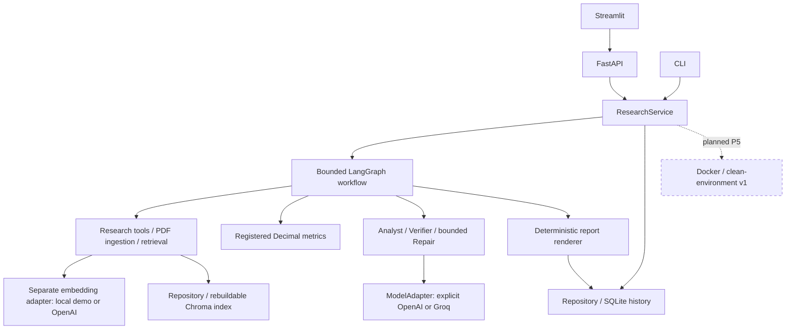

# RiskLens — Evidence-Aware Financial Risk Research Agent

**pre-v1 · work in progress · P4 research evaluation and human review incomplete**

RiskLens explores a practical problem in financial research: an answer can sound convincing
while using the wrong period, miscalculating a ratio, or citing a passage that does not support
its conclusion. This Python prototype connects source evidence, deterministic calculations
and claim-level verification in an inspectable research workflow.

**This is a portfolio snapshot, not a validated financial decision system.** The keyless demo
uses simulated model decisions. No benchmark improvement or Verifier superiority is claimed.

## What is implemented

| Status | Scope |
| --- | --- |
| Implemented and verified with deterministic tests/demo | Bounded LangGraph workflow; Pydantic contracts; PDF ingestion and local retrieval; cutoff/source checks; Decimal financial metrics; conflict/overstatement handling; bounded repair and re-verification; deterministic JSON/Markdown reports. |
| Implemented and verified as product engineering | Shared ResearchService behind CLI/FastAPI, Streamlit via HTTP, SQLite report history, interrupted-run recovery, exports and comparisons that flag unequal source coverage. |
| Implemented with narrow real-provider evidence | Explicit OpenAI/Groq chat adapters, classified errors, zero SDK retries and usage tracking. Prior Groq tool-call/structured-output smoke and a single real development protocol preview exist; the repair arm was partial. |
| Implemented but not validated end to end | Full real-provider research with embeddings/search; real semantic accuracy, injection resistance and financial judgment quality. OpenAI chat transport is unit-tested but no successful live OpenAI run is claimed. |
| In progress | P4 dataset/source review, semantic scoring proposal and valid research evaluation. H4 is not approved. |
| Planned | P5 Docker and clean-environment v1 delivery. No Docker validation or public service deployment is claimed. |

[Actual verification record](docs/evidence/pre-v1/README.md) ·
[Evaluation blockers](docs/evaluation-status.md) · [Resume material](docs/portfolio.md)

## Architecture

Solid boxes/edges are implemented; the dotted path is planned delivery work.



Facts and inferences carry evidence/metric IDs. Citations retain source title, date,
page/section and original quote. The Verifier applies deterministic checks and a separate
semantic interface; only accepted claims enter the final report. Conflicting or unverified
claims remain visible as gaps. A semantic Verifier can still be wrong.

Python `Decimal` implements current ratio, cash ratio, debt/equity, interest coverage and
operating-cash-flow change. Inputs retain units, currency, period and source IDs. Missing
inputs return null; invalid denominators and mismatched periods do not become fabricated
numbers. Risk level, verification status and execution failure are distinct. UNKNOWN is
not LOW, and a failed request is not HIGH risk.

## Quickstart — no API key

Python 3.11 on Linux/WSL. Commands run from the repository root. On a fresh checkout:

```bash
git clone --branch pre-v1 https://github.com/xcai-xinyu/RiskLens.git
cd RiskLens
python3.11 -m venv .venv
source .venv/bin/activate
python -m ensurepip
python -m pip install -r requirements.txt
export PYTHON_DOTENV_DISABLED=1
python scripts/fetch_demo_source.py
python main.py --stage p2 --mode demo --company Coinbase   --question "Assess liquidity and regulatory risks with evidence."   --as-of-date 2025-02-13 --risk-categories liquidity regulatory --format markdown
```

For an existing `finance-agent` checkout, enter that directory and activate its existing
`.venv`; do not create a second environment. Dependencies and the one-time public PDF
acquisition need internet access. After acquisition, demo research needs no provider or
search credentials. The setup script verifies the existing frozen source hash and refuses
to replace different bytes. The issuer PDF is not redistributed in Git.

The example's actual JSON/Markdown outputs are in [the demo evidence bundle](docs/evidence/pre-v1/README.md).
The recorded demo produced `status: partial`, `overall_risk: UNKNOWN`, five accepted fixture
claims, and five metrics marked `missing_input` with null values.

They are labeled **SIMULATED MODEL RESPONSES / REAL FIXED DOCUMENT**. The normal demo can
return `partial` with missing financial inputs; it does not invent ratios to make the UI
look complete. For an inspectable numeric trace and comparison, the optional history seed
below uses explicitly synthetic inputs.

### API and UI (two terminals)

In terminal 1, from the repository root:

```bash
source .venv/bin/activate
export PYTHON_DOTENV_DISABLED=1
python -m uvicorn api.main:app --host 127.0.0.1 --port 8000
```

In terminal 2, from the same repository:

```bash
source .venv/bin/activate
export PYTHON_DOTENV_DISABLED=1
python -m streamlit run frontend/app.py --server.address 127.0.0.1 --server.port 8501
```

Open **http://localhost:8501**; API docs are **http://localhost:8000/docs**.
Choose Coinbase, 2025-02-13 and `demo`, then Run Research. Expand a citation to inspect
its quote/location. Research, Report History and Evaluation are available in the sidebar;
Evaluation is empty until an explicit evaluation artifact exists.

`GET /health` does not call a model. `POST /research` returns `202` and a `run_id`; poll
`GET /runs/{run_id}`. Reports, exports, history and comparisons use the same service.
Unfinished reports have an explicit pending state; unknown IDs return 404. Stop the API
before using the same database with another writer.

### Optional synthetic calculation/history example

With the API stopped, seed its default database, then restart it:

```bash
python evaluation/p3_review_seed.py --database data/private/risklens.sqlite
```

In Report History, open `h3-synthetic-a`, expand a **Calculation** and its citations, and
compare it with `h3-synthetic-b`. They are explicitly synthetic and **not directly comparable**
because coverage/versions differ. Restarting the API retains these reports in SQLite without
requiring the old Chroma index. This seed is a presentation/test fixture, not financial data.

## Modes and configuration

| Mode | Model / documents | Requirements |
| --- | --- | --- |
| `demo` | Simulated role responses; real fixed demo document and deterministic local embedding | Acquire the PDF once; no API key. Synthetic history is separately opt-in. |
| `offline_research` | Real model; fixed local documents, no external search | Explicit chat model/key plus OpenAI embedding model/key for the ResearchService path. |
| `live` | Real model plus authorized search/fetch tools | Above plus Tavily key; end-to-end validation remains outstanding. |

Root `.env` loading is supported; process variables win. `.env.example` contains only empty
secret/model fields and non-secret defaults. The keyless commands disable `.env` loading.
For separately authorized real use, copy the example to `.env`, configure it privately and
unset `PYTHON_DOTENV_DISABLED`. Select `LLM_PROVIDER=openai` with `OPENAI_API_KEY`/`LLM_MODEL`,
or `LLM_PROVIDER=groq` with `GROQ_API_KEY`/`GROQ_MODEL`. No automatic fallback occurs.
Embeddings remain separate (`EMBEDDING_PROVIDER=openai`, `OPENAI_API_KEY`, `EMBEDDING_MODEL`);
Groq chat success does **not** mean the complete RAG pipeline is free or verified.

Calls, tools, repair and total runtime are bounded. SDK retries are disabled; rate limits,
timeouts, quota/balance errors and schema failures are recorded distinctly. Known usage is
retained even after parsing failures; missing usage and unpriced cost remain unknown.

## Evaluation status

P4 research validity remains **FAIL / BLOCKED**, not merely awaiting a benchmark score:

- Frozen v2 has 10 development entries but only 5 distinct questions; reference text leaks
  into all development questions. It cannot support a valid quality comparison.
- Development uses one Coinbase source; the 20 held-out cases are synthetic, and risk-category
  coverage is incomplete. Real development metric coverage is missing.
- Exact-reference scoring cannot resolve semantically correct paraphrases. Gold/source
  review and the replacement real-company candidate set are unfinished.
- A prior real Groq dev-00 run completed A/B/C/D but its separate repair arm hit a 429.
  This is narrow execution evidence, not a completed benchmark or proof of improvement.

[Detailed status and historical evidence](docs/evaluation-status.md). The A/B/C/D harness
preserves shared B/C/D inputs, independent arm records, failures, hashes, versions, latency
and usage. Frozen replay does not validate fresh retrieval. No new provider or held-out
research experiments were run for this publication; human H4/H5 approvals remain outstanding.

## Verification

After acquiring the source:

```bash
PYTHON_DOTENV_DISABLED=1 python -m pytest -q tests
PYTHON_DOTENV_DISABLED=1 python evaluation/run_regression.py
python -m ruff check app api frontend tests scripts main.py
```

These exercise deterministic engineering fixtures, including the historical synthetic P4
split; they do not run a real-model held-out study. See the evidence bundle for actual
commands/results, environment limits and any failures. No static type checker is configured.

## Limitations and roadmap

Single instance with a bounded in-process worker; abandoned work becomes interrupted/failed,
not transparently resumed. Current corpus/company aliases are narrow. Demo decisions are
scripted. Semantic correctness, real-model prompt-injection resistance and risk calibration
remain unproven. This is not investment advice or a trading system.

Next: complete source/gold review and evaluation protocol adoption; obtain reviewed
real-provider development evidence before a valid held-out study; then seek H4. P5 Docker
reproduction and full v1 acceptance follow only after their prerequisites. No hosted service
or v1.0 release accompanies this snapshot.

## References and attribution

[Source provenance, acquisition and code attribution](docs/data-sources.md).
The existing local implementation is retained; no third-party finance-agent repository was
imported. Design references include financial-agent role decomposition and official
[LangGraph](https://docs.langchain.com/oss/python/langgraph/graph-api),
[Pydantic](https://docs.pydantic.dev/latest/concepts/models/),
[FastAPI](https://fastapi.tiangolo.com/) and [Streamlit](https://docs.streamlit.io/) documentation.
Third-party documents/dependencies retain their owners' rights. See the original
[SPEC](SPEC.md), [engineering contract](docs/ENGINEERING_CONTRACT.md) and
[limited publication decision](docs/decisions/0012-public-pre-v1.md).
