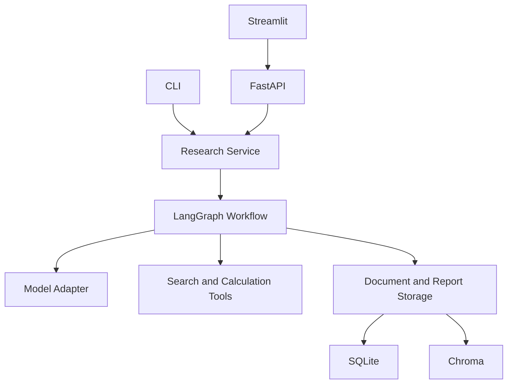
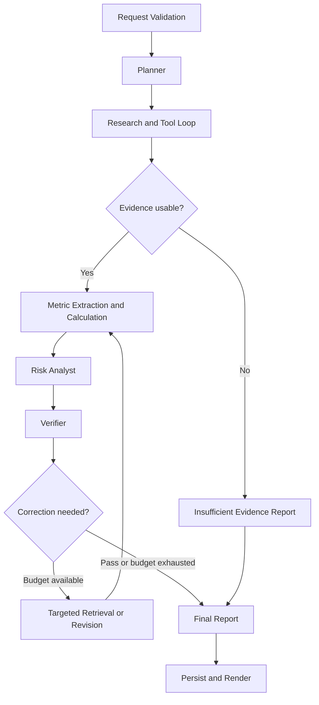

# RiskLens 项目介绍与实施规格

本文档是交给 Codex 的产品与工程实施依据。项目展示 LLM、LangGraph、工具调用、RAG、确定性金融计算、证据验证和可复现评估。先实现可运行的最小闭环，再逐步达到完整 v1。本文定义的是待实现目标，不代表功能已经完成。

## 1 项目定位

**项目名称：RiskLens — Evidence-Aware Financial Risk Research Agent**

**仓库目录：finance-agent**。保留用户已经创建的目录名称，不要求重命名。

中文介绍：RiskLens 是一个金融风险研究系统。用户输入公司、研究问题和截止日期，系统制定研究计划，检索财报、公告及新闻，从原文中提取证据和指标，通过 Python 计算金融比率，再生成风险判断。独立验证步骤检查每条结论与原文、计算结果之间的对应关系，最终输出包含风险因素、引用、证据支持评分、冲突信息和数据缺口的结构化报告。

英文介绍：RiskLens is an evidence-aware financial risk research agent that retrieves company filings and news, computes financial metrics with deterministic tools, and produces structured risk assessments with claim-level citations and verification records. It distinguishes observed facts from analytical inferences and abstains when evidence is insufficient.

核心研究问题：加入证据验证后，能否减少金融研究报告中的无依据结论、错误引用和数值错误？

项目借鉴金融 Agent 的角色分工思想，由自己实现检索、数据契约、计算、验证及评估。README 应注明参考项目与使用的代码来源；不得把运行他人仓库表述为独立实现。

## 2 完整 v1 的边界

| 范围 | 完整 v1 要求 |
| --- | --- |
| 研究对象 | 美国上市公司；先围绕 2–3 家公司的固定资料完成闭环 |
| 风险类型 | 流动性、信用、市场、运营、监管 |
| 输入 | 公司或 ticker、问题、as_of_date、风险类别、运行模式 |
| 资料 | 公司官方财报、公告、本地 PDF/文本；网页与新闻用于补充 |
| 输出 | JSON 与 Markdown 报告，逐项引用、计算记录、冲突与缺失信息 |
| 工作流 | Planner → Research → Metrics → Risk Analyst → Verifier → Report |
| 前端与服务 | Streamlit UI + FastAPI，CLI 也可运行同一服务逻辑 |
| 存储 | SQLite 保存报告与执行记录，Chroma 保存可重建的文档索引 |
| 评估 | 固定证据集上比较 Baseline、Research、Research + Verifier |
| 部署 | Docker Compose 本地复现；公开托管作为后续工作 |

v1 不加入钱包、真实交易、链上执行、模型微调、复杂图数据库或无限循环多 Agent。这些属于后续扩展。完整指研究闭环完整，不代表已经达到金融机构生产系统标准。

使用 Research、Risk Analyst、Verifier 三个逻辑角色即可。Planner 是轻量规划节点；计算和报告渲染是普通 Python 模块。不同角色可以共用一个模型，无须分别部署模型服务。

## 3 用户使用流程

1. 在页面输入公司、问题、研究截止日期，并选择 demo 或 live 模式。
2. 系统解析公司标识，确认研究范围；公司歧义无法消除时返回候选，不猜 ticker。
3. 页面展示阶段状态：规划、检索、指标计算、分析、验证、完成。
4. 用户查看报告中的风险等级、主要驱动因素、事实和推断、原文证据与数据缺口。
5. 点击引用查看原文片段、文档标题、日期、页码或章节及来源链接。
6. 展开计算记录，查看公式、输入数字、单位、期间及输入证据。
7. 下载 JSON/Markdown；从历史记录查看同公司的报告。
8. 比较两个历史报告时展示资料变化、指标变化和结论变化，不把不同模型或资料覆盖造成的变化当作公司风险变化。

示例问题：`Analyze Coinbase's liquidity and regulatory risks using information available as of the selected date.` 示例仅用于说明输入形式，实际风险判断必须来自本次资料。

## 4 技术架构

### 4.1 应用分层



前端通过 API 请求报告；CLI 直接调用同一 ResearchService。业务逻辑不得复制进 UI 或 API 路由。所有模型请求经过 ModelAdapter，所有网络获取经过工具层，所有持久化经过 Repository。

### 4.2 工作流和条件分支



Research 内部允许模型选择授权工具和搜索参数，是受预算约束的 Agent 循环。外层节点顺序、预算、验证门槛由代码控制。RAG 是 Research 的证据检索能力，不是独立的大模型。

默认预算作为配置初值：最大修复轮数 1、总工具调用 12、总 LLM 调用 10、检索返回片段 12、运行超时 180 秒。任何节点开始前检查剩余预算；预算用尽输出 partial 或 insufficient_evidence，不无限重试。

### 4.3 文档进入 RAG 的流程

下载或上传 → 文件类型及大小校验 → PDF/HTML/文本解析 → 保存文档元数据与内容 hash → 按章节或页面分块 → 生成 embedding → 写入索引 → 检索候选片段 → 去重和日期过滤 → 建立 Evidence。

分块起始配置为约 800 tokens、重叠 120 tokens；保留页码或章节边界，测试后再调整。先用向量检索及元数据过滤，关键词重排可作为增强。重排不得改变原文、来源或页码。

## 5 技术选型与职责

| 层 | 选型 | 职责与约束 |
| --- | --- | --- |
| 开发 | WSL + Python 3.11 | 支持 CPU 开发，虚拟环境隔离 |
| 编排 | LangGraph | 共享 State、节点、条件边、有限工具循环 |
| 模型调用 | langchain-openai + ModelAdapter | 首版接一个 provider；模型名由环境变量配置 |
| 数据契约 | Pydantic | 结构化输出、字段验证、JSON 序列化 |
| 搜索 | Tavily adapter | live 模式需要独立 key；离线 fixtures 不依赖搜索 key |
| 文档解析 | pypdf + HTML 文本解析器 | PDF 无文本时记录需 OCR，不伪造提取结果 |
| 向量检索 | Chroma | 单机持久化索引；embedding 模型与维度纳入索引版本 |
| embedding | 可配置 provider | live 首选 API；demo 使用固定本地语料和可重复检索路径 |
| 计算 | Python + Decimal | 固定公式，数字与单位校验；禁止执行 LLM 生成的任意代码 |
| 存储 | SQLite + 本地文档目录 | runs、reports、documents、claims、events |
| API | FastAPI | 输入校验、任务状态、报告与历史记录接口 |
| UI | Streamlit | 输入、进度、引用卡片、报告、对比及评估结果 |
| 观测 | JSON 日志；LangSmith 可选 | 记录阶段、耗时、调用数及 token usage，默认不上传资料 |
| 验证 | pytest + 自定义评估 | 用人工标注和确定性规则作为主要评估依据 |
| 交付 | Docker Compose | API 与 UI 两个服务，持久卷保存数据库及资料 |

不要依据本文猜测 SDK 版本或模型名称。实施时查官方文档，选择兼容版本并提交锁文件。`LLM_MODEL` 和 `EMBEDDING_MODEL` 必须配置，不在代码中固定一个未经验证的名字。没有模型 key 时先跑 demo，live 明确提示配置缺失。

## 6 节点职责与输入输出

| 节点 | 输入 | 输出 | 实现规则 |
| --- | --- | --- | --- |
| Planner | 请求 | ResearchPlan | 分类风险、列出问题、查询和所需指标；不先猜风险结论 |
| Research | 计划、预算 | Documents、Evidence、gaps | 模型选择工具；代码限制调用次数、日期和来源 |
| Metrics | 证据 | MetricInputs、MetricResults | LLM 可提取数字，Python 校验并计算 |
| Risk Analyst | 证据、指标 | DraftClaims、RiskFactors | 事实与推断分开；每条 claim 引用证据或指标 |
| Verifier | 草稿、原文、指标 | VerificationResults | 检查来源、蕴含关系、数值、期间、冲突和夸大措辞 |
| Repair | 验证缺口、预算 | 补充证据或修订草稿 | 只补指定缺口；至多一轮；重新验证修改内容 |
| Report | 已验证结果、缺口 | RiskReport | 确定性渲染引用；无依据条目排除并记录原因 |

Research 工具至少有 `search_web(query, as_of_date)`、`search_documents(query, company_id, as_of_date)`、`fetch_document(url)`。计算工具为 `calculate_metric(metric_name, inputs)`，只允许注册的公式。

工具返回统一结构：`status: success|empty|error`、`data`、`error_code`、`retryable`、`provenance`。空结果与调用失败必须区分。失败不转换成数值 0 或伪造的资料。

## 7 共享 State 和数据契约

LangGraph State 保存结构化数据及引用 ID，避免只传一段不断增长的聊天文本。长原文保存在文档存储中，根据 document_id/chunk_id 获取。

```python
class RiskState(TypedDict):
    run_id: str
    request: dict
    plan: dict
    document_ids: list[str]
    evidence: list[dict]
    metrics: list[dict]
    draft_claims: list[dict]
    verification_results: list[dict]
    gaps: list[dict]
    repair_count: int
    budget: dict
    report: dict | None
    errors: list[dict]
```

实际节点与接口必须使用对应 Pydantic schema 校验上述 dict 内容。

| Schema | 必须字段 |
| --- | --- |
| ResearchRequest | company、question、as_of_date、risk_categories、mode |
| ResearchPlan | company_id、subquestions、search_queries、required_metrics |
| Document | document_id、title、url 或 local_path、source_type、published_at、retrieved_at、content_hash |
| Evidence | evidence_id、document_id、chunk_id、quote、page/section、relevance、source_group_id |
| MetricInput | name、value、unit、currency、period、evidence_id、extraction_status |
| MetricResult | metric_id、name、value 或 null、formula、inputs、status、limitations |
| Claim | claim_id、text、claim_type、risk_category、evidence_ids、metric_ids |
| VerificationResult | claim_id、status、checks、support_score 或 null、explanation、conflicts |
| RiskFactor | category、level、verified_claim_ids、rationale、missing_data |
| RiskReport | run_id、company、as_of_date、status、overall_risk、summary、risk_factors、claims、metrics、sources、gaps、metadata |

枚举：claim_type 为 fact 或 inference；风险等级为 LOW、MEDIUM、HIGH、UNKNOWN；验证状态为 supported、partially_supported、unsupported、contradicted、unverifiable；报告状态为 complete、partial、insufficient_evidence。

引用页码统一保存为阅读器显示的 1-based 页面序号。HTML 记录章节和 chunk_id，不能编造 PDF 页码。

## 8 确定性金融计算

首版实现以下公式。这里的公式是工程规格，不作为自动风险等级阈值。

| 指标 | 公式 | 必要校验 |
| --- | --- | --- |
| Current ratio | current assets / current liabilities | 同日期、同币种；分母必须大于 0 |
| Cash ratio | cash and cash equivalents / current liabilities | 明确 cash 定义，不自行混入受限现金 |
| Debt to equity | total debt / total equity | 明确 total debt 构成；权益非正时标记不可解释 |
| Interest coverage | EBIT / interest expense | 同期间；利息费用非正时不硬算；不得把 EBITDA 写成 EBIT |
| Operating cash flow change | (OCF_current - OCF_previous) / abs(OCF_previous) | 前期为 0 返回不可计算；前期负数或符号反转额外说明 |

每次计算保留输入、公式、单位、期间和 evidence_id。数字提取后检查括号负数、千/百万单位、百分比、币种和财年。优先使用原文中的一致口径，不把不同年度、TTM 和季度数据混算。

缺失数据返回 value=null 和 missing_input；不让模型补数。对于银行、保险等业务结构特殊的公司，注明指标适用性不足或停用对应规则。

## 9 风险分析与证据验证

### 9.1 风险等级

风险等级由可解释的分类 rubric 决定：潜在影响、发生迹象、趋势、缓冲因素、证据缺口。每个类别都有独立 rationale。没有证据的类别为 UNKNOWN，不能默认 LOW。

HIGH 必须有直接的重大风险证据或多个相关且经验证的信号；MEDIUM 表示存在实质风险信号但仍有缓冲或不确定性；LOW 必须有足够支持较低风险的资料。类别 rubric 写入版本化配置，并由人工标注样例检验。总等级取已确认类别中的最高等级，同时列出 UNKNOWN 类别；全 UNKNOWN 时总等级为 UNKNOWN，存在关键缺口时报告为 partial。

### 9.2 验证顺序

1. 确定性检查：ID 存在、quote 能在原文定位、来源日期符合截止日期、单位和期间一致、公式结果可重算。
2. 语义检查：把 claim、引用原文及计算记录交给 Verifier，判断原文是否支持措辞和推断强度；输出结构化理由。
3. 冲突检查：区分数据口径、期间差异、公司说法与监管事实，不把所有不同说法压成共识。
4. 裁决：supported 可进入报告；partially_supported 必须缩小结论后重新验证；unsupported/contradicted 排除；unverifiable 进入缺口记录。

LLM Verifier 也可能出错；它是检查机制，不是独立真相来源。评估需要人工标注或可核对的固定答案，不以模型自评代替事实核验。

### 9.3 证据支持评分

首版可实现可解释的启发式评分，但字段命名为 `evidence_support_score`，不是“结论正确概率”。

候选公式：`score = 0.5 × entailment + 0.3 × source_quality + 0.2 × independent_corroboration`。

entailment 起始映射为 supported=1、partially_supported=0.5；不通过硬检查的 claim 不参与有效评分。source_quality 是按来源类型与结论类型适配的配置评分；官方财报适合核对财务数字，不能自动证明公司所有自述。independent_corroboration 为有独立来源支持时 1、仅单来源时 0；同一公告的转载按 source_group_id 只算一个来源。单一官方原文仍可支持事实，只是独立佐证有限。

公式权重是待实验的设计初值，需要做消融比较；低评分不能直接等于高金融风险。无可核验证据时 score=null。报告汇总评分时同时显示 claim 覆盖率，禁止删去困难 claim 后只展示剩余高分。未校准前 UI 显示“证据支持评分 0–100”，不显示“正确率 86%”。

## 10 时间、来源与数据质量

`as_of_date` 是可使用信息的截止日期。引用资料必须具有可核对的 published_at 且不晚于该日期。retrieved_at 只表示下载时间，不能证明资料当时已公开。无法核对发布时间的内容标记 unknown_date，不用于历史结论。

对动态网页，当前页面即使显示早期发布日期，也可能已被修订；历史研究优先使用固定版本财报或归档快照。严格历史评估只用冻结的可核对证据集。

按 canonical URL、内容 hash 和来源关系去重。优先原始资料；搜索摘要只是发现资料的线索，不作为数字或强风险结论的唯一依据。付费墙、无法下载、空白 PDF、OCR 失败均记录缺口。

上传文档和网页中的指令属于不可信内容，不得改变系统工具权限或泄露 key。抓取限制 http/https、大小、超时，并禁止 localhost、私有 IP、云元数据地址及重定向到这些地址。用户上传文件限制类型及路径，不使用文件名直接拼接存储路径。

## 11 报告与界面

报告包含：研究范围、截止日期、风险概览、各类别 rationale、事实与推断、指标表、逐条引用、验证状态、来源冲突、缺失信息、运行元数据。

报告中的 citation 编号由代码根据 evidence_id 映射生成，LLM 不得编造 URL、页码或来源编号。Summary 只能概括已验证 claims，不能新增未经验证的结论；若用 LLM 生成 summary，须再次执行同样的 claim 验证，首版优先用模板。

UI 页面：Research、Report History、Evaluation。Research 显示输入、阶段进度、报告及来源展开面板；History 支持同公司两份报告比较；Evaluation 展示真实运行的指标，不填示意数值冒充成绩。

历史对比必须显示两个 as_of_date、语料范围和模型/prompt/rubric 版本。资料覆盖明显不同则提示“不可直接比较”，不自动输出风险上升。

## 12 API 与任务执行

| Endpoint | 行为 |
| --- | --- |
| GET /health | 服务存活；不触发模型请求 |
| POST /research | 校验输入、创建任务，返回 202 与 run_id |
| GET /runs/{run_id} | queued/running/completed/partial/failed，当前阶段及错误 |
| GET /reports/{run_id} | 返回报告；未完成时返回明确状态，ID 不存在返回 404 |
| GET /reports | 按公司和日期分页查看历史 |
| GET /reports/{run_id}/export?format=json\|markdown | 导出报告 |
| POST /reports/compare | 接收两个 run_id，返回资料与风险变化及可比性 |

v1 单实例运行，SQLite 存储任务状态，进程内有界队列/worker 执行工作流，限制并发避免数据库写冲突。重启时把遗留 running 任务标记 interrupted，允许用户显式重新运行；不承诺自动恢复。后续需要多实例再引入外部任务队列。

UI 先轮询任务状态。SSE 属于可选增强，仅用于阶段事件，不能作为任务状态的唯一存储。不得直接公开未经脱敏的完整 prompt 或内部思维过程。

## 13 建议目录结构

```text
finance-agent/
  app/
    config.py
    services/research_service.py
    workflows/risk_graph.py
    workflows/state.py
    agents/planner.py
    agents/researcher.py
    agents/risk_analyst.py
    agents/verifier.py
    llm/adapter.py
    tools/web_search.py
    tools/document_search.py
    tools/document_fetch.py
    tools/financial_metrics.py
    rag/ingestion.py
    rag/chunking.py
    rag/retriever.py
    schemas/request.py
    schemas/evidence.py
    schemas/metric.py
    schemas/claim.py
    schemas/report.py
    verification/rules.py
    verification/scoring.py
    storage/repository.py
    reports/renderer.py
    prompts/
  api/main.py
  frontend/app.py
  evaluation/dataset.jsonl
  evaluation/run_eval.py
  evaluation/scorers.py
  evaluation/results/
  tests/unit/
  tests/integration/
  tests/fixtures/
  data/sample/
  docs/architecture.md
  docs/evaluation.md
  main.py
  pyproject.toml
  Dockerfile
  compose.yaml
  .env.example
  .gitignore
  README.md
```

各 Python package 补充 `__init__.py`。实施时按阶段增加文件，不要求第一天创建所有空目录。如果现有项目已有 `app/nodes.py`、`app/graph.py`、`app/state.py`，保留可运行入口，逐步迁移，不直接覆盖。

## 14 运行模式与环境

| 模式 | 依赖 | 目的 |
| --- | --- | --- |
| demo | 固定文档、工具响应及模型响应 fixtures | 无 key 也能展示完整 UI/API 流程；明显标注模拟模型响应 |
| offline research | 固定文档 + 真实 LLM | 测试模型分析和验证；不调用外部搜索 |
| live | 真实 LLM + 搜索 + 文档获取 | 实际研究；记录网络失败与资料日期 |

规划配置：`RUN_MODE`、`LLM_PROVIDER`、`LLM_MODEL`、`OPENAI_API_KEY`、`EMBEDDING_MODEL`、`TAVILY_API_KEY`、`DATABASE_URL`、`DOCUMENT_DIR`、`VECTOR_DIR`、`MAX_TOOL_CALLS`、`MAX_LLM_CALLS`、`MAX_REPAIR_ROUNDS`、`RUN_TIMEOUT_SECONDS`。`.env.example` 只含占位符。

统一 CLI 目标：`python main.py --mode demo --company Coinbase --question "Analyze liquidity risk" --as-of-date YYYY-MM-DD`。README 用真实 fixture 的截止日期替换占位符。API 和 UI 启动命令在实现后验证再写入 README。demo 不可用于声称真实金融分析或模型性能。

## 15 评估设计

先标注 10 个开发问题，最终建立约 30 个固定问题，覆盖五类风险、资料缺失、冲突、单位错误及日期泄漏。开发集和保留测试集按公司或文档组分开，避免同一证据片段泄漏。少量人工标注集只能支持有限结论，必须说明样本数。

每条 case 包含 question、company、as_of_date、document_ids、reference_claims、gold_evidence_ids、reference_metrics、expected_gaps。标注注明结论是事实、可接受推断或不能推断。

比较三个方案：A 为无检索原始 LLM；B 为同样 Research + Analyst；C 为同样 Research + Analyst + Verifier。B/C 使用相同资料快照、模型、问题和提示预算，额外验证成本单独报告。增加 D：只使用确定性检查，用于区分规则检查和语义 Verifier 的贡献。

| 指标 | 定义 |
| --- | --- |
| Citation coverage | 带可解析引用的事实 claims / 全部事实 claims；无事实 claims 记 N/A |
| Citation correctness | 引用确实支持对应 claim 的数量 / 被检查引用数量 |
| Unsupported claim rate | unsupported 或 contradicted claims / 全部已评价 claims |
| Numerical accuracy | 数值、公式、单位和期间全部正确的计算项 / 已评价计算项 |
| Answer completeness | 覆盖的 reference 要点 / reference 要点数 |
| Abstention accuracy | 应当拒绝判断或标记缺失的 case 中正确处理的比例 |
| Latency and cost | 总耗时、工具/模型调用数、实际 usage；未知成本不能记 0 |

基线可能通过不输出具体结论提高部分指标，必须同时报告 completeness 与 abstention。人工检查引用与结论支持关系，LLM judge 仅作辅助；条件允许对部分样本双人复核并记录分歧。

保存逐 case 结果、失败案例、语料 hash、model、prompt/rubric 版本、运行日期、随机性设置与实际 token usage。价格需要版本化来源才能估计费用，否则只报告 tokens。不使用 live 搜索的变动结果作为可复现实验的主证据。

评估目标是检验 Verifier 是否有效，不预设一定改善，不在 README 预填性能提升。

## 16 错误处理和观测

外部请求设置超时；429 和短暂 5xx 有限重试，鉴权失败不盲目重试。结构化输出解析失败允许一次修复，仍失败返回明确错误。run、node、tool 都记录耗时和状态；LLM 日志记录模型与 usage，缺失 usage 标记 unknown。

研究任务失败与“研究发现风险高”是不同状态。网络失败、解析失败、资料不足应在 UI 单独说明。日志中移除 API keys、完整用户上传敏感原文和未脱敏 request headers。

记录输入请求、模型/prompt/rubric 版本、来源 hash、计算输入、验证结果、预算消耗及错误，以便复盘一份报告的生成过程。默认不把文档和 prompt 上传到第三方观测服务。

## 17 两周实施顺序与阶段验收

| 阶段 | 时间参考 | 工作 | 必须验收 |
| --- | --- | --- | --- |
| P0 | Day 1–2 | 检查现有项目；配置、schemas、单节点图、CLI、demo fixtures | 无 key 可跑 demo；有 key 可独立做真实结构化模型调用 |
| P1 | Day 3–4 | 文档解析、索引、Research 工具循环、Analyst、引用 | 固定资料完成查询，原文可定位；发布候选 v0.1 |
| P2 | Day 5–7 | 指标计算、Verifier、一次修复、最终报告 | 缺失数字不补数；错误引用和夸大 claim 被拦截 |
| P3 | Day 8–10 | FastAPI、UI、SQLite 历史、评分及报告对比 | UI 请求贯通；重启记录保留；不同资料覆盖不强行比较 |
| P4 | Day 11–12 | 固定评估集、A/B/C/D 对比、失败案例 | 保存真实逐项结果，能重复运行，报告成本和质量取舍 |
| P5 | Day 13–14 | Docker、README、演示、清理与集成检查 | 新环境按文档启动；demo 与 live 明确区分；交付 v1 |

时间是目标而非保证。必须保证阶段闭环再加下一项；时间不足时先推迟 SSE、高级重排和历史分析增强，不删掉引用、缺失处理和评估来堆界面。

## 18 完整 v1 验收清单

- [ ] CLI、API、UI 复用同一 ResearchService。
- [ ] Research 至少有一次真实模型选择工具的执行记录；demo 记录明确标为模拟。
- [ ] 财报或本地文档走实际解析与检索，引用能定位到原文。
- [ ] 每项最终事实 claim 均有可解析引用；无支持结论不进入正式报告。
- [ ] 数值来自可追踪输入；同单位、同期间校验生效。
- [ ] 缺失资料输出 UNKNOWN 或 partial，不默认为低风险。
- [ ] Verifier 的数值错误、引用错误、过强推断及冲突场景有有效测试。
- [ ] 修复循环和总预算有限；异常路径可结束。
- [ ] 截止日期过滤及历史资料限制有测试。
- [ ] SQLite 重启后保留报告；中断任务有明确状态。
- [ ] 固定证据集评估可复现，包含删减回答造成 completeness 降低的案例。
- [ ] `.env`、keys、数据库、私人文档、缓存均不提交 Git。
- [ ] Docker demo 能运行；live 配置与失败处理写入 README。
- [ ] README 区分已完成、计划、局限、实际评估结果及参考项目。

必须覆盖的测试案例：分母为零、负权益、百万单位换算、错误页码、quote 不存在、虚构 evidence_id、来源晚于截止日期、同源新闻重复、监管消息互相矛盾、工具超时、模型结构解析失败、预算耗尽、上传文档中的恶意指令。真实 API 集成测试可单独 opt-in，默认测试不产生外部账单。

## 19 可直接复制给 Codex 的执行指令

> 请依据本文件，在当前 finance-agent 项目中逐阶段实现 RiskLens。先检查 AGENTS.md、现有目录、代码和依赖，说明当前状态，再完成 P0。保留已有可运行功能和用户文件，不重新生成整仓库。
>
> 实现原则：LangGraph 控制有限工作流；模型负责规划、工具选择、证据分析和语义验证；Python 负责公式、数据校验、引用映射及持久化。先建立 Pydantic 数据契约和可重复的 demo，再接真实 provider。
>
> 不要一次生成全部功能，也不要只建立空文件夹。P0 必须交付一条可执行命令、运行结果、必要测试和简短说明。没有 API key 时完成可执行 demo 并明确模拟范围；真实模型路径保留并清楚说明尚未验证。不要读取或打印秘密值，不把 fixtures 伪装成真实金融数据。
>
> 后续每次按下一阶段推进：实现 → 运行 → 修复 → 更新 README。只跑与改动有关的必要检查。阶段完成后说明实现内容、实际验证结果、未完成项和下一条操作命令。不得虚构评估结果、模型支持能力或外部服务成功记录。GitHub push、公开发布及真实交易不属于本文件默认授权范围。

## 20 后续扩展

v1 验收后可增加 SEC 等原始数据连接器、混合检索与 reranker、更大人工评估集、独立来源识别、评分校准、可恢复任务队列，以及 DeFi 协议风险资料。链上执行另建明确的权限与风险边界，保持研究报告系统可独立运行。

## 21 实施时参考的官方资料

以下资料用于核对库的当前接口；本文的产品范围、预算、评分和架构是项目设计选择。

- LangGraph Graph API：https://docs.langchain.com/oss/python/langgraph/graph-api
- LangGraph Workflows and Agents：https://docs.langchain.com/oss/python/langgraph/workflows-agents
- LangChain Structured Output：https://docs.langchain.com/oss/python/langchain/structured-output
- FastAPI SSE 可选增强：https://fastapi.tiangolo.com/tutorial/server-sent-events/

不要将参考资料中的示例版本直接当作项目锁定版本。实施时验证所选 SDK、模型的 tool calling 和 structured output 支持，并保存兼容依赖。
